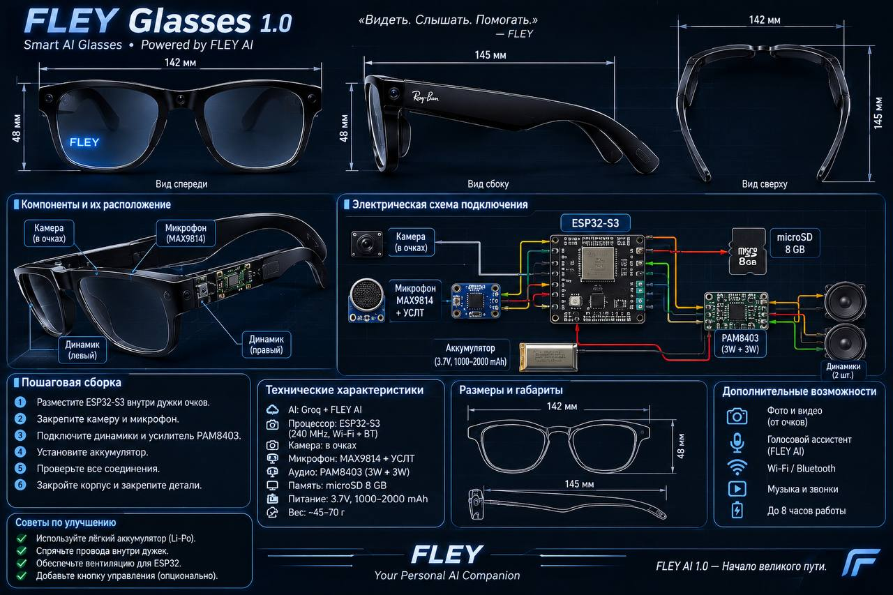

# FLEY Glasses 1.0

**Smart AI Glasses • Powered by FLEY AI**  
> *«Видеть. Слышать. Помогать.» — FLEY*



**FLEY Glasses 1.0** — проект умных очков со встроенным ИИ-ассистентом на базе микроконтроллера **ESP32-S3** (в стиле E.D.I.T.H.). Устройство распознаёт голосовые команды, анализирует изображение с камеры в реальном времени, оценивает угрозы вокруг, сохраняет фотографии на карту памяти и озвучивает ответы через встроенные в дужки динамики.

---

## Возможности системы

* **Голосовой ассистент:** Запись речи с микрофона **MAX9814**, распознавание через **Groq Whisper** (`whisper-large-v3-turbo`), генерация ответа языковой моделью (`openai/gpt-oss-120b`) и озвучка через OpenAI-совместимый TTS (`gpt-4o-mini-tts`).
* **Компьютерное зрение:** Анализ того, что видит пользователь, по запросам *«что я вижу»*, *«посмотри»*, *«прочитай»*, *«что написано»*, *«переведи надпись»* (используются модели `qwen/qwen3.8-27b` и запасная `meta-llama/llama-4-scout-17b-16e-instruct`).
* **Скан окружения (оценка безопасности):** По команде *«скан»* или *«оцени опасность»* ИИ анализирует обстановку и присваивает уровень угрозы (**НИЗКИЙ**, **СРЕДНИЙ** или **ВЫСОКИЙ**), предупреждая о транспорте, препятствиях, ступенях, огне, дыме и других опасностях.
* **Режим охраны (Патруль):** Автоматическое периодическое сканирование обстановки (по умолчанию каждые 20 секунд). Ассистент подаёт тревожный сигнал, сохраняет кадр на карту памяти и озвучивает предупреждение только при обнаружении угрозы.
* **Фотофиксация и управление:** Сохранение снимков на карту **microSD** по команде *«сфотографируй»*, регулировка громкости голосом (*«громче»* / *«тише»*), управление кнопкой (короткое нажатие — голосовой запрос, удержание 1.5 сек — включение/выключение режима охраны).
* **Конфиденциальность:** В системных промптах жёстко заложен запрет на идентификацию личностей по лицам — описывается только количество людей, их позы, одежда и действия.

---

## Технические характеристики и габариты

* **Процессор:** ESP32-S3 (240 МГц, Wi-Fi + Bluetooth, рекомендуется модуль N16R8 с 16 МБ Flash и 8 МБ OPI PSRAM)
* **Камера:** OV2640 на гибком шлейфе FPC (раскладка Freenove ESP32-S3-WROOM CAM / ESP32-S3-EYE)
* **Микрофон:** MAX9814 с автоматической регулировкой усиления (АРУ)
* **Аудиосистема:** Стереоусилитель PAM8403 (3W + 3W) + 2 динамика (левый и правый в дужках)
* **Память:** Карта microSD (подключение по 1-bit SD_MMC)
* **Питание:** Аккумулятор Li-Po 3.7V (1000–2000 mAh) с платой зарядки и повышающим преобразователем до 5V / 3.3V (до 8 часов автономной работы)
* **Габариты оправы:** Ширина — 142 мм, длина дужки — 145 мм, высота оправы — 48 мм
* **Вес устройства:** ~45–70 г

---

## Компоненты и схема подключения

### Расположение узлов в корпусе
* **Фронтальная часть оправы:** Камера OV2640 (в переносице/рамке) и микрофон MAX9814.
* **Дужки очков:** Плата ESP32-S3, усилитель PAM8403, слот microSD, аккумулятор и левый/правый динамики.

### Распиновка (GPIO)

| Компонент | Вывод модуля | Пин ESP32-S3 | Примечание |
| :--- | :--- | :--- | :--- |
| **Микрофон MAX9814** | `OUT` | `GPIO 1` | АЦП (ADC1_CH0), питание `3V3` и `GND` |
| **Усилитель PAM8403** | `L` + `R` | `GPIO 21` | Вывод звука через ШИМ + RC-фильтр (1 кОм + 10 нФ на GND) |
| **Кнопка управления** | — | `GPIO 14` | Второй контакт на `GND` (опционально) |
| **Карта microSD** | `CLK` | `GPIO 39` | Режим SD_MMC 1-bit |
| **Карта microSD** | `CMD` | `GPIO 38` | Режим SD_MMC 1-bit |
| **Карта microSD** | `D0` | `GPIO 40` | Режим SD_MMC 1-bit |
| **Камера OV2640** | `XCLK` / `SIOD` / `SIOC` | `15` / `4` / `5` | Стандартная раскладка ESP32-S3-EYE / Freenove CAM |
| **Камера OV2640** | `VSYNC` / `HREF` / `PCLK` | `6` / `7` / `13` | — |
| **Камера OV2640** | `Y2`..`Y9` | `11, 9, 8, 10, 12, 18, 17, 16` | Шина данных камеры |

> **Примечание по аудио:** У ESP32-S3 отсутствует встроенный ЦАП, поэтому вывод звука реализован через высокочастотный ШИМ (`156250 Гц`) с RC-фильтром. Для более чистого звучания можно заменить PAM8403 на I2S-усилитель **MAX98357A**.

---

## Пошаговая сборка

1. Разместите плату **ESP32-S3** внутри дужки очков.
2. Закрепите камеру **OV2640** во фронтальной части оправы и установите микрофон **MAX9814**.
3. Подключите левый и правый динамики к усилителю **PAM8403** и соедините его с `GPIO 21` через RC-фильтр.
4. Установите лёгкий аккумулятор **Li-Po 3.7V** с контроллером заряда и преобразователем питания.
5. Проверьте все соединения и отсутствие коротких замыканий.
6. Закройте корпус дужек и зафиксируйте детали (при необходимости предусмотрите вентиляционные отверстия для охлаждения ESP32-S3 и кнопку на `GPIO 14`).

---

## Настройка и прошивка (Arduino IDE)

### 1. Подготовка среды
* Установите ядро **esp32 by Espressif Systems** версии **3.x** через *Boards Manager*.
* Установите библиотеку **ArduinoJson** (Benoit Blanchon) версии **7.x** через *Library Manager*.

### 2. Параметры платы в меню «Инструменты»
* **Плата:** `ESP32S3 Dev Module`
* **USB CDC On Boot:** `Enabled` (обязательно для работы Serial-монитора)
* **Flash Size:** `16MB (128Mb)`
* **Partition Scheme:** `Huge APP (3MB No OTA/1MB SPIFFS)`
* **PSRAM:** `OPI PSRAM` (для модулей N16R8) или `QSPI PSRAM` (для N8R2)

### 3. Конфигурация в коде
Перед загрузкой скетча заполните свои данные в разделе `НАСТРОЙКИ ПОЛЬЗОВАТЕЛЯ`:

```cpp
#define WIFI_SSID        "ВАШ_WIFI"
#define WIFI_PASS        "ВАШ_ПАРОЛЬ"
#define GROQ_API_KEY     "gsk_..." // Ключ API Groq для STT, LLM и Vision
#define TTS_API_KEY      "sk-..."  // Ключ OpenAI API для голосовой озвучки (если пусто — только текст и сигналы)
```

---

## Голосовые команды

* **Диалог:** Любой вопрос или фраза (например: *«Привет, Флей, как обстановка?»*).
* **Зрение:** *«Посмотри»*, *«Что я вижу?»*, *«Что передо мной?»*, *«Прочитай»*, *«Что написано?»*, *«Переведи надпись»*.
* **Безопасность:** *«Скан»*, *«Оцени обстановку»*, *«Проверь опасность»*, *«Что вокруг?»*.
* **Режим охраны:** *«Включи охрану»* / *«Режим охраны»* / *«Патруль»* (отключение: *«Отбой»* / *«Выключи охрану»*).
* **Камера и звук:** *«Сфотографируй»* / *«Сделай снимок»*, *«Громче»*, *«Тише»*.
